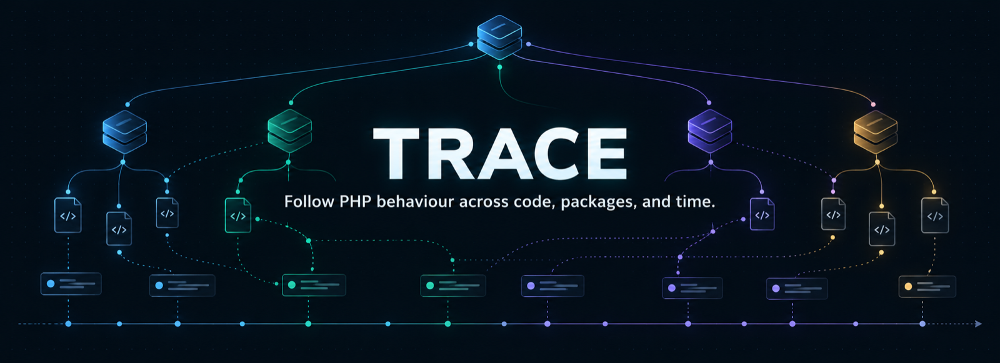
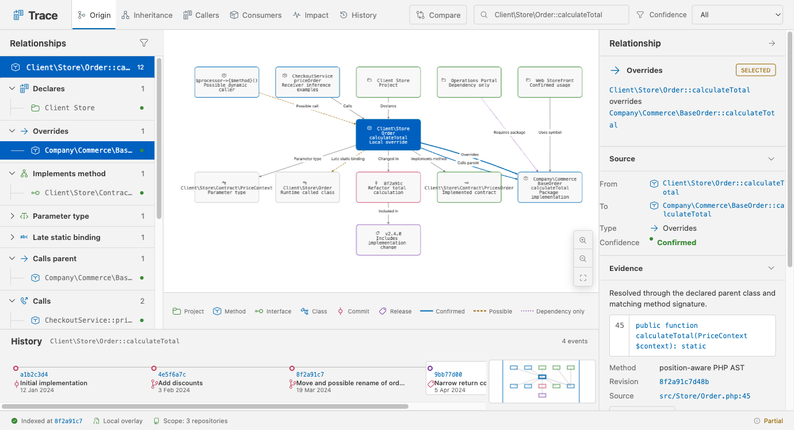
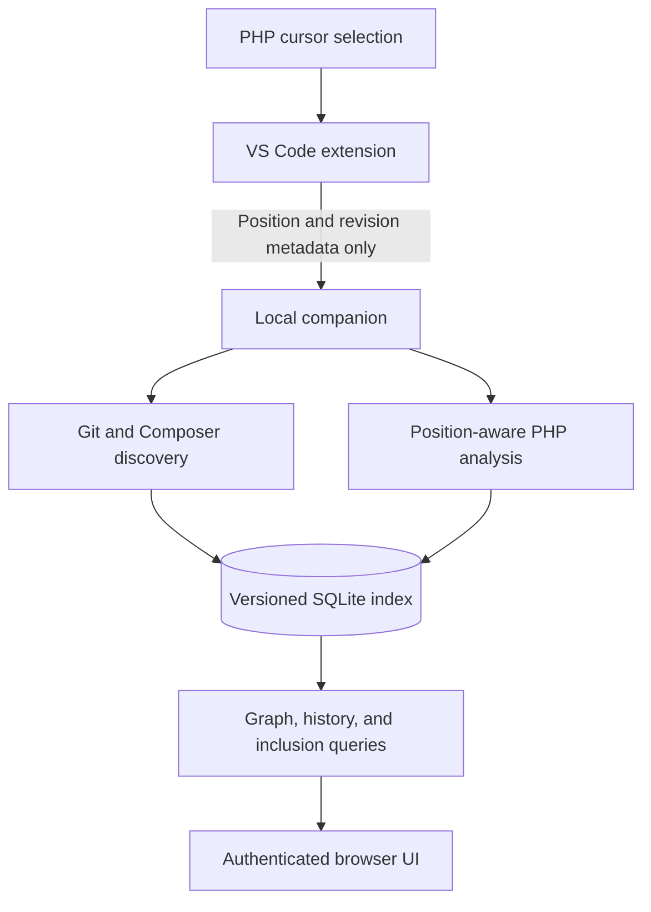
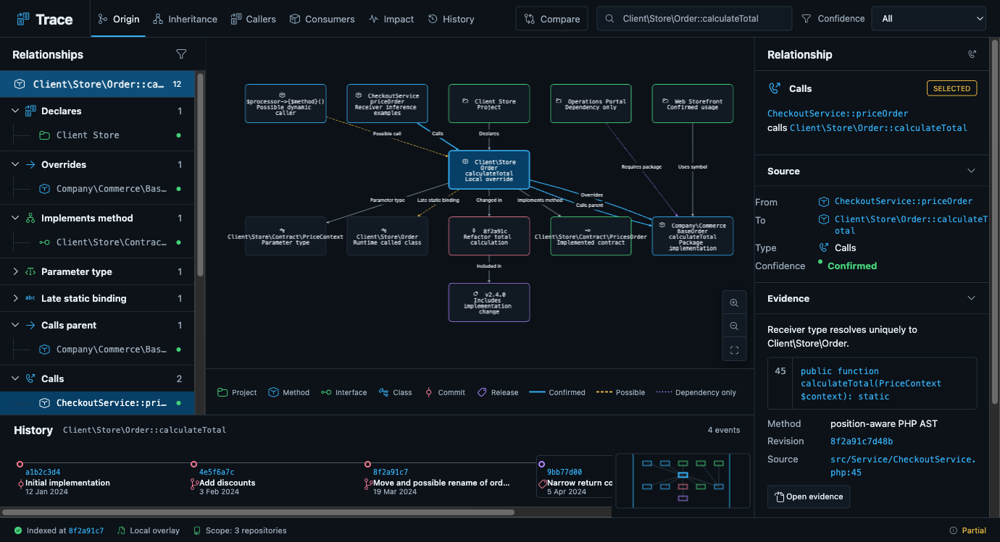
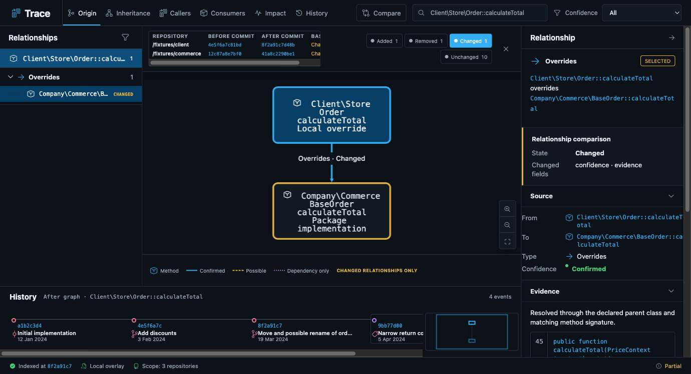
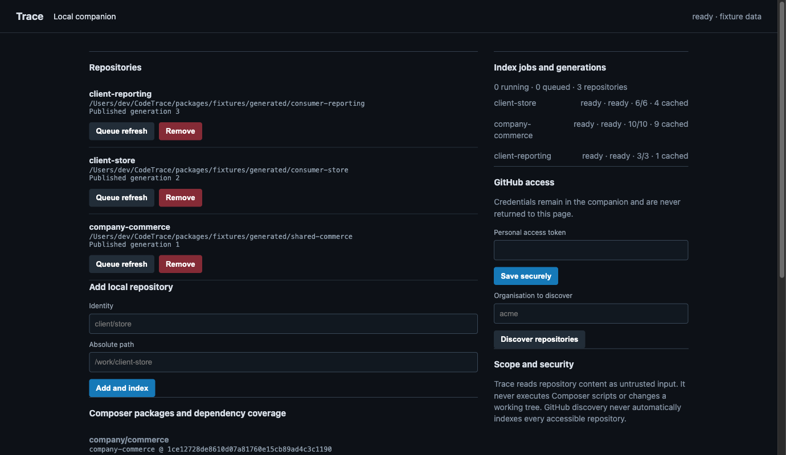

<p align="center">
  
</p>

# Trace

Trace is a VS Code extension and local companion for understanding where PHP behaviour comes from, what it can affect, which Composer projects consume it, and how it changed over Git history.

Select a class or method in VS Code, open Trace in your browser, and move through an evidence-backed graph that follows the editor context. Every relationship carries its source, exact revision, confidence, and known limitations. Dynamic behaviour is shown as uncertain instead of being guessed.

**Local-first · Read-only worktrees · PHP and Composer · VS Code**

[Quick start](#quick-start) · [What Trace can answer](#what-trace-can-answer) · [How it works](#how-it-works) · [Configuration](#configuration) · [Documentation](#documentation)

<picture>
  <source media="(prefers-color-scheme: dark)" srcset="docs/assets/readme/trace-overview-dark.png">
  <source media="(prefers-color-scheme: light)" srcset="docs/assets/readme/trace-overview-light.png">
  
</picture>

<p align="center"><em>Fixture-backed relationship data. GitHub automatically selects the light or dark capture.</em></p>

## What Trace can answer

- **Where did this method come from?** Follow overrides, parent calls, interfaces, traits, return types, parameter types, and late-static bindings.
- **What calls or consumes it?** Separate confirmed callers from possible dynamic dispatch and package installation without observed symbol use.
- **What could this change affect?** Explore a bounded, top-to-bottom impact graph across local code and exact Composer relationships.
- **When did it change?** Inspect introduction, implementation, signature, documentation, formatting, move, and possible rename evidence from Git objects.
- **Where is the change present now?** Compare release and consumer revisions using ancestry, equivalent patches, and revert-aware active-behaviour evidence.
- **What changed between two historical bases?** Reconstruct both revision-qualified graphs and compare added, removed, changed, and unchanged relationships.

> [!IMPORTANT]
> Trace provides static-analysis and Git evidence. It does not execute the application, resolve runtime containers, prove deployment, or claim that a relationship ran in production.

## Quick start

### Requirements

- Node.js 22.13 or newer
- npm 10 or newer
- Git
- VS Code 1.95 or newer

PHP is useful for exploring the example source, but the indexer does not execute PHP, Composer scripts, or repository code.

### 1. Build Trace

```sh
cd CodeTrace
npm install
npm run build
```

This repository does not currently publish Trace to the VS Code Marketplace; use an Extension Development Host or build the local VSIX.

### 2. Prepare the safe example repositories

If `packages/fixtures/generated/fixture-manifest.json` is not present:

```sh
npm run fixture
```

The generator creates three disposable Git/Composer repositories under `packages/fixtures/generated/`. It refuses to overwrite a non-empty fixture destination.

### 3. Start the local companion

```sh
TRACE_FIXTURE_MODE=1 npm start -w @trace/companion
```

The companion listens on `http://127.0.0.1:47173`, indexes the fixture repositories, and stores its token and SQLite state under `~/.trace`. Keep this terminal running.

### 4. Launch the extension

In another terminal:

```sh
code --extensionDevelopmentPath="$PWD/packages/extension" "$PWD/packages/fixtures/generated"
```

In the Extension Development Host:

1. Copy the token without printing it: `pbcopy < ~/.trace/client-token` on macOS.
2. Run **Trace: Set Companion Client Token** and paste it.
3. Open `consumer-store/src/Order.php` and put the cursor on `calculateTotal`.
4. Click the primary **Trace** status item or run **Trace: Open Trace**.

The extension requests a short-lived, single-use browser launch from the companion. The browser should open the Trace relationship view with the local override in focus, plus its package implementation, callers, contracts, consumers, and fixture history. Keep the browser visible and move to another indexed PHP symbol in VS Code; the graph follows the latest editor context after the default 300 ms debounce.

> [!TIP]
> On Linux or Windows, read `~/.trace/client-token` with a local command appropriate for your shell, then paste it into the VS Code command. Do not put the token in workspace settings, a URL, or source control.

<details>
<summary><strong>Install a local VSIX instead</strong></summary>

```sh
npm run package:extension
code --install-extension packages/extension/trace-vscode-*.vsix --force
```

Reload VS Code, start the companion, set the client token, and open a PHP workspace. The packaged extension and companion should come from the same checkout so their protocol versions match.

</details>

## How it works



The extension owns workspace discovery, scan status, settings, and publication of the active editor's repository, revision, relative path, cursor range, and bounded theme kind. It does not publish selected or document source text to the browser context channel. The companion owns indexing, Composer resolution, Git history, optional GitHub access, persistence, and the primary browser UI. Published generations are replaced atomically, so an interrupted refresh leaves the previous graph usable.

[Read the architecture and data model](docs/architecture.md)

## Features

### Evidence-backed PHP relationships

Trace resolves namespaces and aliases, declarations, inheritance, interfaces, traits, parent calls, native and PHPDoc types, local receiver flows, and supported direct calls. The synchronized relationship tree provides a keyboard-readable alternative to the visual graph, while the inspector shows the exact source range and reasoning behind the selected edge.

PHP call flow is laid out from top to bottom: callers appear above the method they call, with arrows pointing toward the callee.

### Honest receiver inference

Native properties, promoted properties, constructor assignments, local `new` expressions, variable aliases, branch candidates, and native method returns retain their provenance. Union or PHPDoc-only receivers stay possible. Container lookups, reflection, runtime class strings, magic calls, and dynamic method names remain explicitly unresolved.



### Composer identity without false joins

Trace keeps the declared constraint, branch, inline alias, locked version, source reference, installed path, repository URL, and indexed revision separate. Explicit mappings win; otherwise canonical paths and exact source identity outrank package-name guesses. Ambiguous forks remain ambiguous even when they share a Git object.

[See the Composer resolution view](docs/visual-guide.md#composer-resolution)

### History, adoption, and revision comparison

History is read directly from Git objects without checking out another revision. Trace can follow confirmed file moves, cautiously associate a unique structural method rename, find equivalent patches such as cherry-picks, and assess whether the newest comparable matching patch is applied or reverted.

Historical graph comparison requires an explicit commit for each repository on each side. Missing objects fail instead of silently falling back to the active index.



Optional GitHub enrichment associates the exact selected commit with pull requests and same-name releases. These associations are presented separately from local inclusion and never imply merge, deployment, or execution.

### Automatic, bounded indexing

Workspace discovery and Composer expansion are automatic by default. Work enters a bounded queue with duplicate coalescing, backpressure, separate repository/file concurrency, cancellation, persisted job stages, and atomic generation publication. Active graph queries scope work to the selected repository and relevant exact package neighbours instead of rebuilding every indexed package.



The companion writes state to `~/.trace` by default. It does not create indexes, manifests, or caches inside repositories being scanned.

### Editor-to-browser workflow

- The primary **Trace** status item and exploration commands open the authenticated loopback browser UI.
- The extension publishes the latest eligible PHP cursor position after a 300 ms debounce; superseded editor work is cancelled.
- Legacy Origin, Inheritance, Callers, Consumers, Impact and History commands select the matching browser mode before launch.
- Browser launches use a short-lived, single-use ticket exchanged for an HttpOnly, SameSite browser session; the client token is not stored by browser JavaScript.
- The context channel sends repository/path/revision/range metadata and a bounded light/dark/high-contrast theme kind only. Unsaved source and selected-text contents stay out of browser payloads.
- Scans read the project while all index, session and cache state remains in the companion data directory.

[Browse every captured feature and UI state](docs/visual-guide.md)

## Confidence model

| State | Meaning |
| --- | --- |
| **Confirmed** | Supported by exact static, Composer, or Git evidence at the stated revision. |
| **Possible** | A bounded candidate exists, but PHP/runtime or lineage evidence cannot prove one exact target. |
| **Dependency only** | Composer installs the package, but indexed source does not show exact symbol use. |
| **Unresolved / dynamic** | Runtime data, reflection, a container, magic dispatch, or unavailable evidence prevents a safe target claim. |

Partial results remain usable but carry an explicit limitation—for example a graph-node cap, unresolved dependency identity, bounded Git traversal, or optional remote API failure.

[Read the complete analysis contract](docs/analysis-confidence.md)

## Configuration

The defaults are sufficient for the fixture quick start.

| Setting | Default | Purpose |
| --- | ---: | --- |
| `trace.companionUrl` | `http://127.0.0.1:47173` | Loopback companion endpoint; non-loopback URLs are rejected. |
| `trace.requestTimeoutMs` | `30000` | Companion request timeout. |
| `trace.followActiveEditor` | `true` | Publish eligible active PHP cursor context to the companion browser. |
| `trace.autoScanWorkspace` | `true` | Discover eligible local Git/Composer roots automatically. |

Companion queue controls include `TRACE_REPOSITORY_CONCURRENCY`, `TRACE_ANALYSIS_CONCURRENCY`, `TRACE_MAX_QUEUE`, `TRACE_AUTO_SCAN`, and `TRACE_WATCH`. Keep `TRACE_HOST` on loopback.

[Configuration example](docs/trace.config.example.json) · [Large-workspace tuning](docs/performance-privacy.md)

## Optional GitHub integration

Local tracing needs no GitHub credential. For pull-request/release association or opt-in repository discovery, provide a least-privilege token to the companion through `TRACE_GITHUB_TOKEN` for the current process or the authenticated local admin page. The token is not returned by the API or included in graph payloads.

[Security and credential boundaries](docs/security.md)

## Development

```sh
npm run check
npm run build
npm test
```

Useful commands:

```sh
npm run dev:companion      # companion with Node watch mode
npm run fixture            # generate deterministic Git/Composer fixtures
npm run package:extension  # build the installable VSIX
```

The fixtures and focused tests cover PHP relationships, receiver uncertainty, Composer precedence, graph layout, historical reconstruction, move/rename lineage, equivalent patches, reverts, optional GitHub association boundaries, queueing, cancellation, browser-session authentication, and source-free editor-context publication.

## Troubleshooting

| Symptom | Check |
| --- | --- |
| Companion offline | Start `npm start -w @trace/companion`; confirm the extension uses the same loopback port. |
| Authentication paused or HTTP 401 | Copy the current client-token file and run **Trace: Set Companion Client Token** again. |
| Protocol mismatch | Rebuild the companion and VSIX from the same checkout, reinstall with `--force`, and reload VS Code. |
| Repository stays queued | Open the companion admin page from the browser's settings control and inspect the job stage/failure before retrying. |
| Browser asks for a token | Click the Trace status item to mint a fresh one-time launch, or paste the local client token into the fallback form. The form clears it after exchange. |
| Browser stays on “Waiting for an active PHP selection” | Focus an indexed local PHP file in VS Code, confirm `trace.followActiveEditor` is enabled, and wait for the repository generation to become ready. |
| Missing package relationship | Inspect installed path, lock source identity, repository candidates, revision coverage, and explicit mappings. |

For a complete acceptance tour, use the [manual verification guide](docs/manual-verification.md).

## Documentation

- [Visual feature guide](docs/visual-guide.md)
- [Architecture and data flow](docs/architecture.md)
- [Analysis confidence and limitations](docs/analysis-confidence.md)
- [Large-workspace scanning, queues, benchmarks, and privacy](docs/performance-privacy.md)
- [Security model](docs/security.md)
- [Manual verification guide](docs/manual-verification.md)
- [Configuration example](docs/trace.config.example.json)

## Current scope

Trace 0.1.0 is a local development build focused on PHP, Composer, Git, and VS Code. It deliberately does not execute code or invent runtime relationships. Dynamic dispatch, service-container resolution, reflection/generated code, ambiguous fork identity, non-unique renames, semantic equivalence beyond textual patch evidence, and perfectly synchronized time snapshots across repositories remain limited or unresolved by design.

The repository currently has no licence file or published support/contribution policy; this README does not infer one.
