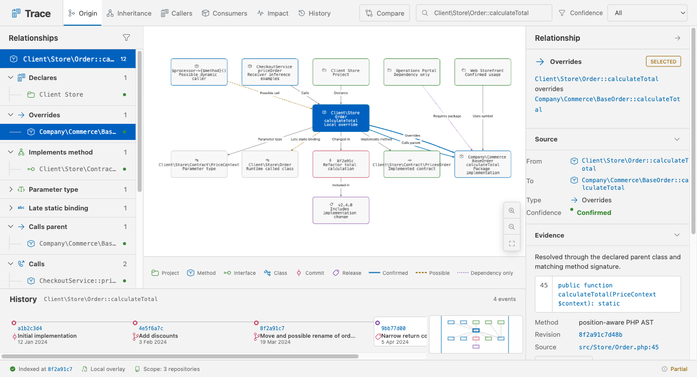
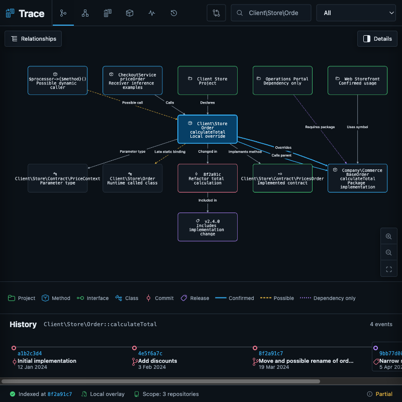
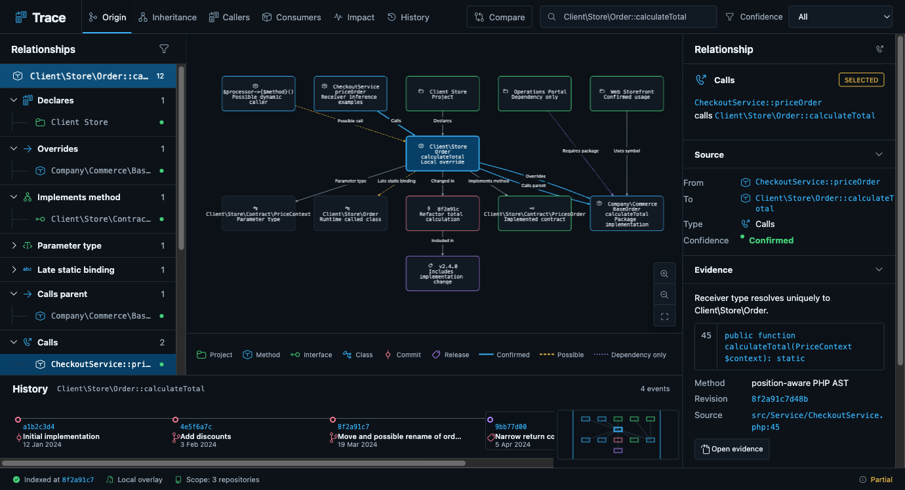
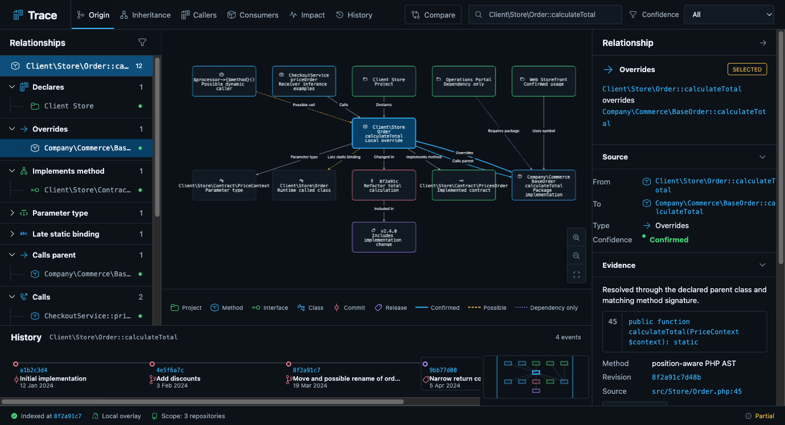
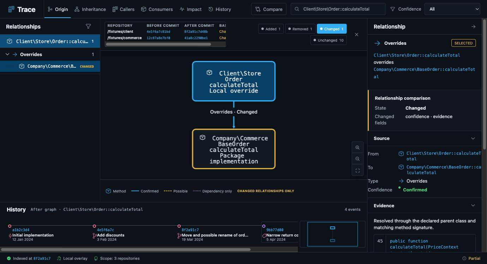
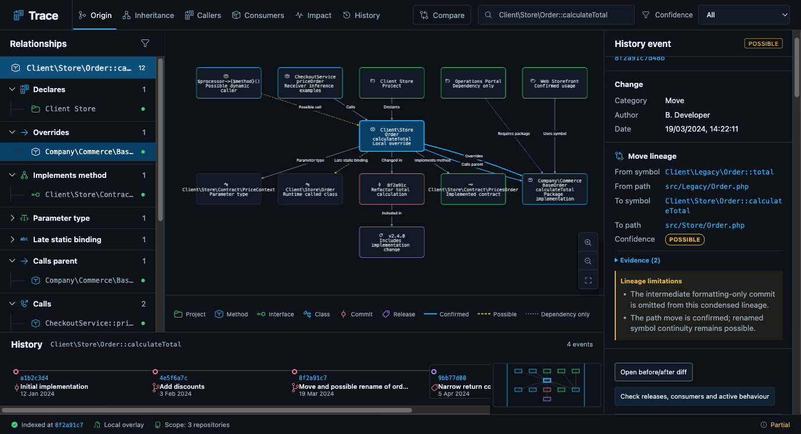
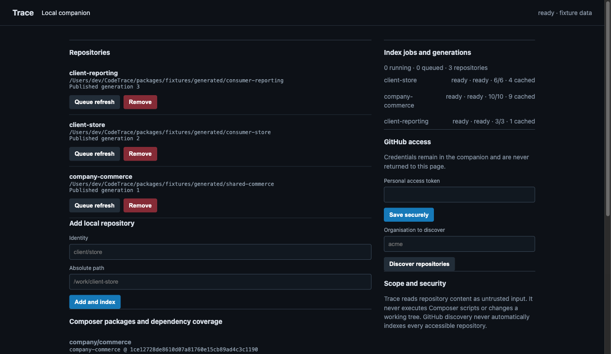

# Trace visual feature guide

These captures use deterministic fixture repositories. They contain no customer source, credentials, client tokens, personal data, or private remote URLs. The browser is the primary live relationship UI and uses the same graph/evidence renderer represented here.

The relationship captures use a 1380 × 749 CSS-pixel viewport. The compact capture uses 800 × 800. Screenshots show synthetic repository identities and intentionally fictional GitHub association data.

## Feature coverage

| Surface | Capture |
| --- | --- |
| Relationship graph, tree, evidence, history, confidence, search and modes | [Overview](#relationship-overview) |
| VS Code light/dark theme integration | [Overview](#relationship-overview) |
| Responsive compact layout | [Compact layout](#compact-layout) |
| Native, ambiguous, container and dynamic receiver evidence | [Receiver inference](#receiver-inference) |
| Composer constraint, alias, source, path and indexed identity | [Composer resolution](#composer-resolution) |
| Exact before/after graph bases and relationship diff | [Historical comparison](#historical-comparison) |
| Consumer/release active behaviour and optional GitHub associations | [Release and pull-request association](#release-and-pull-request-association) |
| Repositories, generations, jobs, mappings and optional GitHub setup | [Companion dashboard](#companion-dashboard) |

## Relationship overview

The overview brings the accessible relationship tree, directed graph, evidence inspector, history timeline, confidence filter, and freshness/partial status into one editor surface.

<picture>
  <source media="(prefers-color-scheme: dark)" srcset="assets/readme/trace-overview-dark.png">
  <source media="(prefers-color-scheme: light)" srcset="assets/readme/trace-overview-light.png">
  
</picture>

## Compact layout

Below 960 px, the relationship and detail rails collapse behind labelled controls while the graph and history remain available.

## Receiver inference

The inspector distinguishes precise native/local candidates from branch ambiguity and runtime-only behaviour. It states why no precise target was claimed instead of manufacturing a graph edge.

## Composer resolution

The package inspector keeps a dependency's declared constraint, base branch, inline alias, locked source/dist identity, installed path, indexed repository and selected resolution evidence separate.

## Historical comparison

Each side is reconstructed from an explicit repository-to-commit map. The view preserves the bases and filters added, removed, changed, and unchanged relationships.

## Release and pull-request association

Local inclusion and revert-aware active behaviour remain primary. Optional GitHub pull-request and release associations are separate, bounded metadata with their own confidence and limitations.

## Companion dashboard

The authenticated loopback dashboard exposes repository generations, bounded scanner jobs, Composer dependency coverage, explicit mappings, optional GitHub access, and the read-only security boundary.

## Capture boundary

The editor-context publisher and browser-follow behaviour are verified with fixture data rather than private workspace screenshots. Safe procedures are documented in the [manual verification guide](manual-verification.md#3-extension-development-host).
